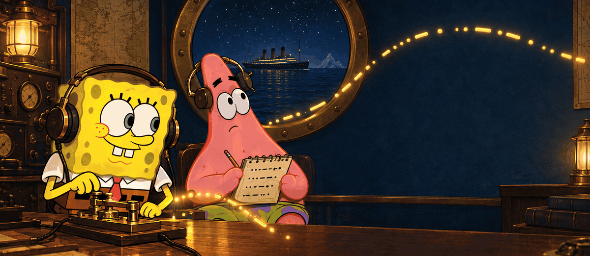

<div align="center">



# Learn Morse, Save Titanic

> **Notice**: This project is developed strictly for educational and self-learning purposes.

<p>A clean, zero-dependency terminal application designed to teach International Morse code letter by letter, followed by practicing ear-training on reconstructions of historical 1912 wireless transmissions.</p>

</div>


## Quickstart

This application runs directly with the Python Standard Library. No external packages, build tools, or third-party drivers are required.

```bash
python main.py
```

### Options

```bash
# Force direct Windows hardware beep buzzer
python main.py --backend winbeep

# Run in visual Morse flashing mode
python main.py --visual

# Adjust speed or frequency
python main.py --wpm 10 --freq 700

# Disable terminal colors
python main.py --no-color
```

---

## Features

- **Standard Library Only**: Waveform synthesis, PCM encoding, and OS playback run entirely on built-in Python modules (`math`, `array`, `wave`, `winsound`, `subprocess`).
- **Farnsworth Timing**: Implements the standard Farnsworth method. Characters are transmitted at full recognition speed (18 WPM), with extended pauses between characters and words for beginners.
- **Click-Free Audio Synthesis**: Tones use an 8 ms raised-cosine envelope to eliminate acoustic clicks, with a hard amplitude limit to maintain comfortable volume.
- **Cross-Platform Playback**: Automatically routes to native system audio (`winsound` or `winbeep` on Windows, `afplay` on macOS, `paplay`/`aplay` on Linux), with real-time visual fallback.
- **Structured 8-Stage Curriculum**: Progression starts with fundamental signals (`E, T`), expands through opposites and full alphabet mastery, and culminates in numerals, punctuation, and distress signals.
- **Mastery Gating & Interleaved Review**: Unlocks new characters only upon reaching 90% accuracy over 10 or more attempts, while periodically reinforcing weaker characters.
- **Operator Logbook**: Tracks accuracy per character, logged attempts, and common confusion patterns across sessions.
- **Historical Reconstruction Simulation**: Decode sequential 1912 wireless messages segment by segment, accompanied by historical context.

---

## In-Session Commands

During any active decoding drill:
- `:r` - Replay current transmission.
- `:h` - Display hint (element count).
- `:s` - Skip current item.
- `:q` - Save progress and return to the main menu.
- `:speed <number>` - Change playback speed on the fly (e.g. `:speed 12`).

---

## Project Structure

```text
Morse/
├── main.py                  # Entry point
├── pyproject.toml           # Project metadata
├── requirements-dev.txt     # Optional developer tools (pytest, ruff)
├── README.md                # Documentation
├── LICENSE                  # MIT License
├── banner.gif               # Application header
├── data/
│   ├── morse_table.json     # Morse code specification
│   ├── curriculum.json      # Staged learning progression
│   └── titanic_messages.json# Historical candidate transmissions
├── morse_titanic/
│   ├── app.py               # Menu loop and CLI options
│   ├── audio.py             # Timing math, PCM synthesis, and playback backends
│   ├── morse.py             # Morse translation and input normalizer
│   ├── grading.py           # Answer normalization and diff comparison
│   ├── progress.py          # Atomic JSON progress persistence
│   ├── learn.py             # Lesson flow, audio drills, and mastery gating
│   ├── titanic.py           # Historical simulation and educational viewer
│   ├── dataset.py           # Schema and transmission validation
│   └── ui.py                # ANSI formatting and prompt handlers
└── tests/                   # Test suite
```

---

## Development & Verification

To run tests and linter locally:

```bash
python -m venv .venv
.\.venv\Scripts\activate
pip install -r requirements-dev.txt

ruff check .
pytest -v
```

---

## License

This software is licensed under the [MIT License](LICENSE).

---

## Author & Contact

- **Author**: Abdelilah Belyagoubi
- **GitHub**: [BELYAGOUBIABDELILAH](https://github.com/BELYAGOUBIABDELILAH)
- **Email**: belyagoubiabdillah@gmail.com
